  <picture>
    <source media="(max-width: 600px)" srcset="https://raw.githubusercontent.com/ioskpu/ioskpu/main/assets/header-movil.svg" />
    
  </picture>

### 🛠️ Lo que estoy construyendo

| Proyecto | Qué es | Stack |
| --- | --- | --- |
| 🛒 [**macmovil.com**](https://macmovil.com) | Tienda en línea en producción: catálogo, carrito, pagos con Wompi, envíos por zonas, cupones y panel de administración con roles. | React · Node · MySQL |
| 🎮 [**Mini-Web3-Game-Economy**](https://github.com/ioskpu/Mini-Web3-Game-Economy) | Ecosistema Web3 mínimo: NFTs, staking ponderado por rareza y token de recompensa ERC-20. | TypeScript · Solidity |
| 🤖 [**BotSentinelTelegram**](https://github.com/ioskpu/BotSentinelTelegram) | Asistente para monitorear criptoactivos con datos en tiempo real y alertas por Telegram. | Python |
| 📜 [**Notarizacion**](https://github.com/ioskpu/Notarizacion) | Prueba on-chain de que un hash SHA-256 existía en una fecha concreta (Polygon Amoy). | JavaScript · Solidity |
| 💵 [**DolarAcurastVE**](https://github.com/ioskpu/DolarAcurastVE) | Monitoreo descentralizado del dólar oficial en Venezuela con computación distribuida. | JavaScript |

### 📊 Actividad

  

